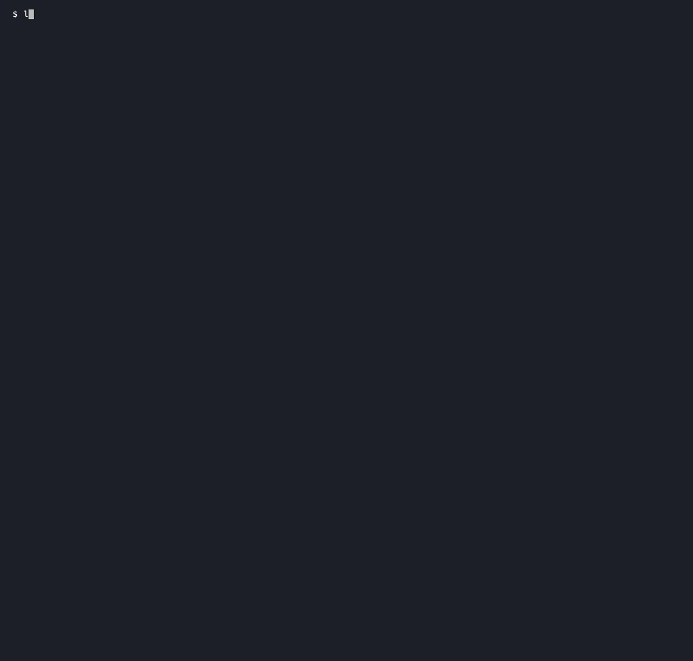

# lastmod-ledger

See which sitemap dates moved with your files across two saved site snapshots.

[](https://github.com/itzjk/lastmod-ledger/actions/workflows/test.yml)
[](LICENSE)



## Quick start

Install with Python 3.9+ and pipx on Linux or macOS:

```sh
pipx install git+https://github.com/itzjk/lastmod-ledger.git
```

Point the command at two local manifests:

```sh
lastmod-ledger compare before.json after.json
```

Each manifest names an existing sitemap and explicitly maps public URLs to local files. Paths are relative to that manifest, including paths into a sibling snapshot directory. Save this shape as `before.json`, then create `after.json` pointing at the other snapshot:

```json
{
  "sitemap": "before/sitemap.xml",
  "files": [
    {"url": "https://example.test/alpha", "file": "before/Alpha.html"}
  ]
}
```

## Features

- Cross declared dates with SHA-256 hashes, retaining both sides of each observation.
- Review both discordant combinations without treating either as an SEO failure.
- Keep added URLs, missing files, missing dates and ambiguous duplicates visible.
- Export versioned JSON with entry provenance, file sizes and full hashes.
- Read existing snapshots without running builds, fetching pages or changing dates.

## Why

An XML diff reveals date changes; a file diff reveals byte changes. Neither alone shows whether the generator's declared dates moved alongside the associated files. [Google's guidance](https://developers.google.com/search/docs/crawling-indexing/sitemaps/build-sitemap#additional-notes-about-xml-sitemaps) ties `lastmod` to significant updates, while the [sitemap protocol](https://www.sitemaps.org/protocol.html#xmlTagDefinitions) makes it optional; the [reproduction and alternative trials](docs/alternatives.md) document this narrower inspection task without claiming measured customer demand.

## How it works

The command parses both XML files, matches exact decoded `loc` values, and hashes the mapped files' exact bytes. It reports `bytes-changed/date-unchanged`, `bytes-unchanged/date-changed`, and the two agreeing combinations. Whitespace and link changes count as byte changes. HTTP, HTTPS, trailing slashes and query variants stay separate. Two explicitly mapped URLs may share one file. Missing or ambiguous observations never become an unchanged result.

## Usage

| Command or option | Purpose |
| --- | --- |
| `compare BEFORE AFTER` | Compare two local manifests |
| `--json` | Emit `schema_version: 1`, including coverage |
| `--max-entries N` | Cap XML entries and mappings per side, default 50,000 |
| `--max-manifest-bytes N` | Cap each manifest, default 4 MiB |
| `--max-sitemap-bytes N` | Cap each XML, default 16 MiB |
| `--max-file-bytes N` | Cap each mapped file, default 32 MiB |
| `--max-total-bytes N` | Cap reads across both snapshots, default 512 MiB |
| `--version` | Print the installed version |

Exit **0** means complete comparison with no discordant pairs; **1** means review candidates; **2** means incomplete coverage, including added/removed URLs or an empty comparison; **3** means an input error. Code 2 retains any review candidates already found. These codes describe observations, not approval to deploy. See the [report contract](docs/report.md) for count relationships and provenance.

## FAQ

**Does a discordant pair mean the date is wrong?** No. An edit may be minor, happen on the same day, or involve resources outside the mapped file. Both bytes and date changing also cannot certify a date.

**Does this replace my sitemap generator?** Keep your generator. Provide the XML it already produced and the files you want to compare.

**Can an unmapped page disappear from the report?** Every sitemap URL stays in coverage. Duplicate XML entries or manifest mappings remain ambiguous rather than picking a winner.

**Does it touch Git or access the network?** The comparison only reads local regular files. It uses neither Git history nor file timestamps to infer content changes.

## Limitations

- One uncompressed XML `urlset` per snapshot, with the sitemap namespace. Full calendar dates (`YYYY-MM-DD`) are compared; valid datetime or reduced precision values are reported as outside this subset.
- Indexes, extensions and malformed entries are identified as coverage gaps. This is not a full sitemap schema validator.
- Symlinks, including parent directories, are rejected. Snapshots must be stable: identity, size and timestamps are checked around reads and again before reporting. These checks detect observed concurrent changes, without providing atomic reads.
- Hashes establish byte differences, not editorial importance, actual modification times, penalties, ranking or crawl effects.

## Contributing

From a clone, install with `python -m pip install '.[test]'` and run `python -m pytest -q`; the [fixture guide](docs/development.md) reproduces both demos.

## License

[MIT](LICENSE).
